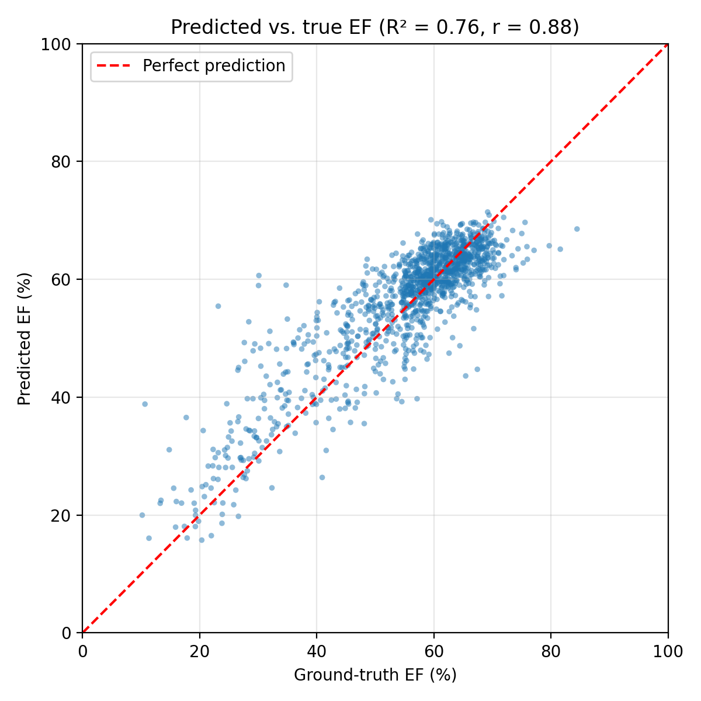
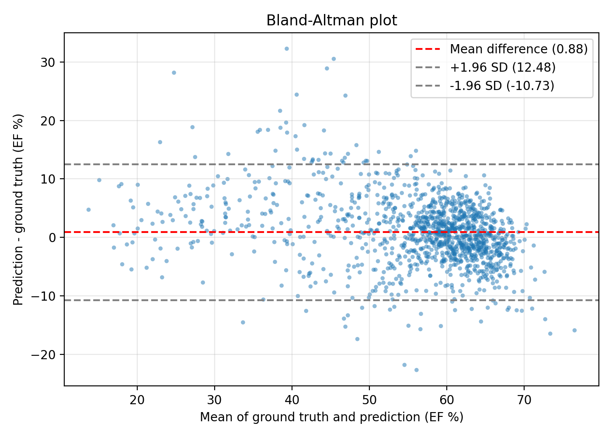
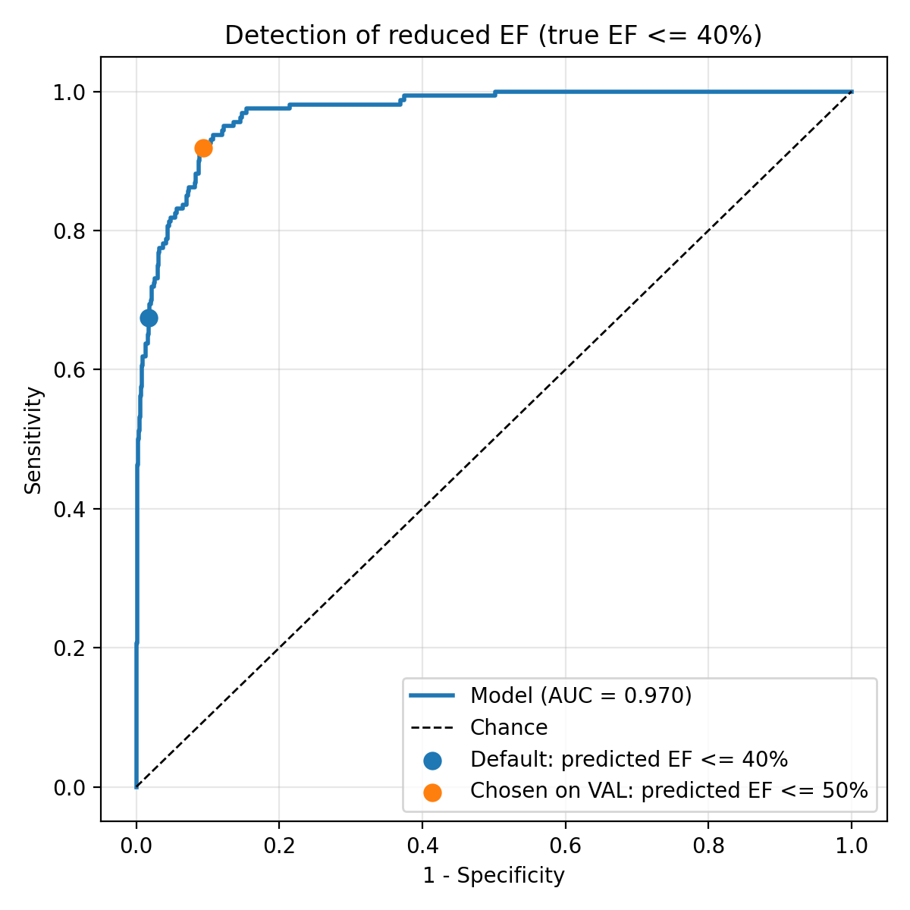
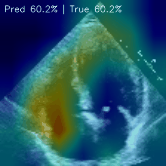
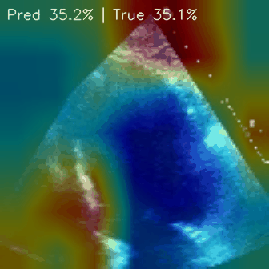
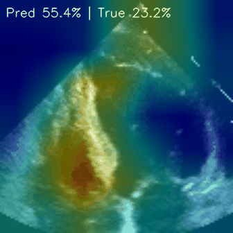

# Echocardiographic Ejection Fraction Estimation with R(2+1)D-18

Deep-learning pipeline that estimates the **left ventricular ejection fraction (EF)** directly from
echocardiogram videos. It fine-tunes a video CNN (R(2+1)D-18, pretrained on Kinetics-400) with a regression head
on the public EchoNet-Dynamic dataset, and includes a full evaluation, a screening analysis for reduced EF,
and Grad-CAM visualisations.

> **Research and educational project. Not a medical device. Do not use for clinical decisions.**

## Results

All numbers below were computed with the scripts in this repository on the held-out **TEST split of
EchoNet-Dynamic (1,277 videos)**. The model checkpoint and the screening cut-off were chosen on the
validation split only.

| Split | Videos | MAE (EF points) | RMSE | R² | Pearson r |
|-------|-------:|----------------:|-----:|----:|----------:|
| Validation | 1,288 | 4.31 | 5.95 | 0.766 | 0.876 |
| **Test** | **1,277** | **4.40** | **5.98** | **0.761** | **0.875** |

Bland-Altman analysis on the test set: mean difference +0.88, 95% limits of agreement -10.7 to +12.5 EF points.

<p align="center">
  
  
</p>

### Detecting reduced EF (true EF <= 40%)

AUC on the test set: **0.970**. A video raises an alert when the *predicted* EF is at or below a cut-off.
The 49.9% cut-off was selected on the validation split (Youden index) and then applied to the test split;
the other rows are fixed cut-offs shown to illustrate the trade-off.

| Alert if predicted EF <= | Sensitivity | Specificity | PPV | NPV |
|-------------------------:|------------:|------------:|----:|----:|
| 35% | 0.488 | 0.997 | 0.963 | 0.931 |
| 40% | 0.675 | 0.983 | 0.850 | 0.955 |
| 45% | 0.775 | 0.963 | 0.752 | 0.968 |
| **50% (chosen on VAL)** | **0.919** | **0.906** | **0.583** | **0.987** |

At the 50% cut-off the model works as a *rule-out* screen (high NPV), but roughly four in ten alerts are false
alarms (PPV 0.58). Predictive values depend on how common reduced EF is in the data.

<p align="center"></p>

### Grad-CAM examples

Qualitative examples chosen from the test set: an accurate normal case, an accurate reduced-EF case, and
the case with the largest error. They were selected from the best and worst predictions, so they are not
representative of average behaviour.

| Accurate, normal EF (true 60.2%, predicted 60.2%) | Accurate, reduced EF (true 35.1%, predicted 35.2%) | Largest error (true 23.2%, predicted 55.4%) |
|:--:|:--:|:--:|
|  |  |  |

## Method

- **Data:** EchoNet-Dynamic, 10,030 apical four-chamber echo videos (112x112) with EF labels;
  7,465 train / 1,288 validation / 1,277 test (the official split).
- **Input:** 32 frames sampled uniformly over each video, normalised with Kinetics-400 statistics.
- **Model:** R(2+1)D-18 backbone (pretrained on Kinetics-400) with a head
  `Dropout(0.3) - Linear(512, 256) - ReLU - Dropout(0.3) - Linear(256, 1)`.
- **Training:** SmoothL1 loss, AdamW (lr 1e-4, weight decay 1e-4), cosine schedule, mixed precision, batch size 16,
  up to 20 epochs with early stopping on validation MAE (best epoch: 18). Augmentation: random rotation (15 degrees)
  and brightness/contrast jitter. Trained on 2x NVIDIA T4 GPUs (Kaggle), about 6.5 minutes per epoch.
  The training log is kept in `notebooks/training_kaggle.ipynb`.
- **Explainability:** Grad-CAM on the last residual block (`layer4[-1]`), upsampled to the input clip.

## Installation

```bash
git clone https://github.com/suleman-zaher00/echonet-ef-estimation.git
cd echonet-ef-estimation
python -m venv .venv
# Windows: .venv\Scripts\activate    Linux/macOS: source .venv/bin/activate
pip install -r requirements.txt
```

Developed and tested with Python 3.13, PyTorch 2.13 and torchvision 0.28 on Windows 11 (CPU inference).

## Data and weights

- **Dataset:** download EchoNet-Dynamic from the [official page](https://echonet.github.io/dynamic/) and accept its
  terms of use. The data is not redistributed here. Put it in `data/EchoNet-Dynamic/` (it must contain
  `FileList.csv` and `Videos/`), or point to it with the `ECHONET_ROOT` environment variable.
- **Weights (126 MB):** download `best_model_release.pth` from the
  [v1.0 release](https://github.com/suleman-zaher00/echonet-ef-estimation/releases/tag/v1.0), save it as
  `weights/best_model.pth` (or keep the name and pass `--weights`, or set `EF_WEIGHTS`).
  SHA-256: `8c58d2d55e409ff648648641e1d869ad5ad6706f5c557d692390407c3e5e2f31`

## Usage

```bash
# Full evaluation on the test split (about 15 minutes on a laptop CPU)
python -m src.evaluate

# Quick smoke test on 20 videos
python -m src.evaluate --limit 20

# Reduced-EF screening analysis from saved predictions
python -m src.threshold_analysis --select-on outputs_val/predictions.csv   # after: python -m src.evaluate --split VAL --out-dir outputs_val

# Grad-CAM for a random test video, or a specific one
python -m src.gradcam
python -m src.gradcam --file 0X32D38BB19B226A8C

# Predict EF for a single video (optionally with a Grad-CAM GIF)
python -m src.predict path/to/video.avi --gradcam
```

## Project structure

```
src/
  config.py              paths (overridable by environment variables) and constants
  dataset.py             EchoNet-Dynamic video dataset
  model.py               EFRegressor and weight loading
  evaluate.py            metrics, scatter plot, Bland-Altman plot
  threshold_analysis.py  ROC curve and screening cut-off analysis
  gradcam.py             Grad-CAM for 3D CNNs (PNG and GIF)
  predict.py             single-video inference
  export_weights.py      strip a training checkpoint down to the release weights
notebooks/training_kaggle.ipynb   training run and log
results/                 metrics and predictions used in this README
assets/                  figures
```

## Limitations

- **Single-centre data:** EchoNet-Dynamic comes from one hospital. There is no external validation, so
  performance on other scanners, populations or views is unknown.
- **Regression to the mean:** low EF values are over-estimated on average (see the scatter plot), which is why
  sensitivity at the 40% cut-off is only 0.675. Some errors are large (up to 30+ EF points).
- **Wide agreement limits:** the 95% limits of agreement are about -11 to +12 EF points, which is too wide for
  clinical use on individual patients.
- **Fixed frame sampling:** 32 frames are sampled uniformly over the entire video, without detecting cardiac cycles.
- **Grad-CAM is illustrative:** the heatmaps are low-resolution and their focus varies between videos. They do not
  prove that the model relies on specific anatomical structures.
- **Per-frame augmentation:** augmentation was applied independently to each frame during training; applying one
  consistent transform per clip is a likely improvement.

## References

- Ouyang D. et al. *Video-based AI for beat-to-beat assessment of cardiac function.* Nature 580, 252-256 (2020).
  (EchoNet-Dynamic dataset and baseline.)
- Tran D. et al. *A Closer Look at Spatiotemporal Convolutions for Action Recognition.* CVPR 2018. (R(2+1)D.)
- Selvaraju R. R. et al. *Grad-CAM: Visual Explanations from Deep Networks via Gradient-based Localization.*
  ICCV 2017.

## License

Code is released under the MIT License (see `LICENSE`). The EchoNet-Dynamic data and any weights trained on it
are subject to the dataset's own terms of use.
